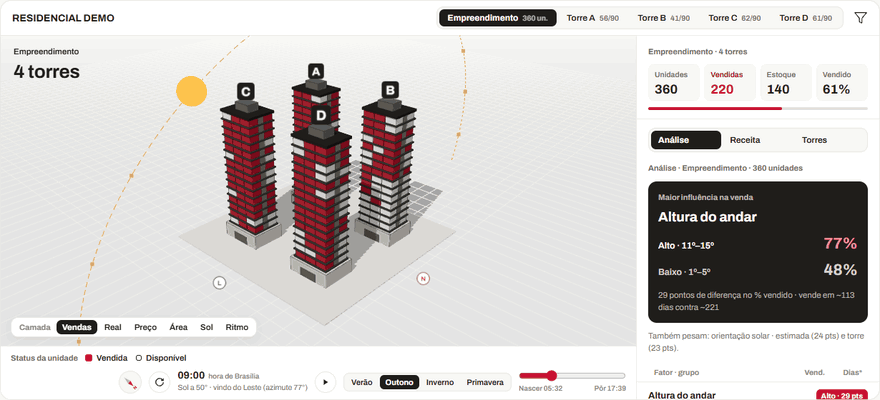
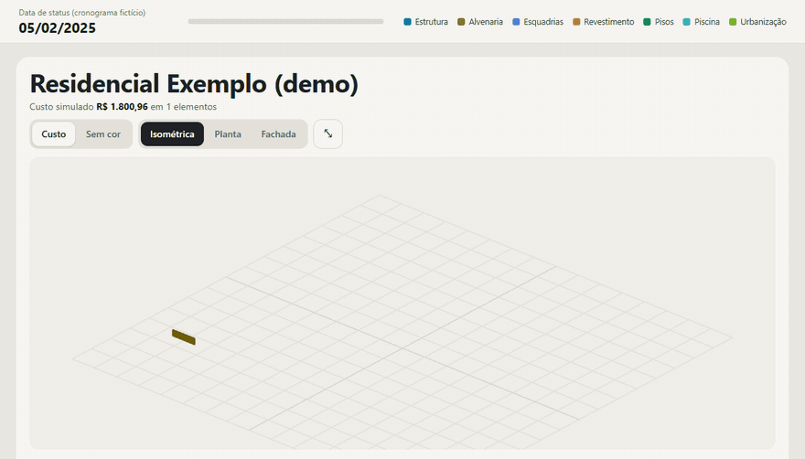
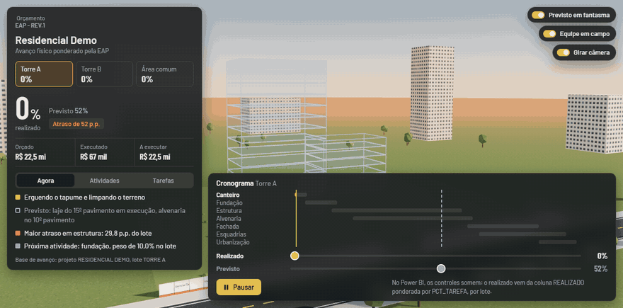
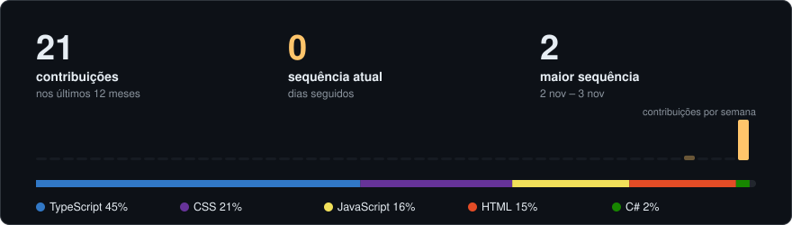

  

  
  

<h3 align="center">about</h3>

  Data &amp; BI developer. I turn raw data into models, dashboards and tools people actually use.

  
    data warehouse &amp; sql&nbsp;&nbsp;·&nbsp;&nbsp;power bi / dax&nbsp;&nbsp;·&nbsp;&nbsp;python for etl &amp; automation&nbsp;&nbsp;·&nbsp;&nbsp;data apps with typescript
  

<h3 align="center">stack</h3>

  
  
  
  
  
  
  
   
  
  
  
  
  

<h3 align="center">portfolio · projetos de B.I. em Power BI</h3>

<b>tudo aqui é B.I.</b>: cada projeto abaixo roda dentro de um relatório <b>Power BI</b>, como visual personalizado (pbiviz, TypeScript + three.js)

lê as tabelas do modelo de dados (SQL Server / DW → Power Query → DAX), responde aos filtros e segmentações da página e filtra os outros visuais ao clicar · dados das demos são fictícios

  

  <b>Power BI · Espelho de Vendas 3D</b> 
  cada apartamento vira um bloco no prédio, pintado por situação, R$/m², horas de sol real (posição do sol por hora e estação) ou dias até a venda · na camada Real, luz e sombra seguem o sol de verdade (hora, estação, latitude) · painel ao lado mostra o que mais pesa na venda · clique filtra o relatório

  

  <b>Power BI · Revit / IFC com visão 5D</b> 
  modelo exportado do Revit em IFC lido direto no relatório (three.js + web-ifc, sem Revit instalado) · cada peça ligada a uma linha pelo GlobalId · 3D + cronograma (4D) + custo por composição (5D): o condomínio inteiro (muro com gradil, guarita, 3 torres com vigas, varandas e cobertura, salão de festas, academia, churrasqueira, piscina, quadra, pet place, quiosques, vias, vagas e paisagismo) vai sendo construído na data de status e o orçamento acompanha

  

  <b>Power BI · avanço de obra em 3D, realizado × previsto</b> 
  canteiro inteiro em 3D (gruas, equipe, máquinas) montado a partir do avanço físico ponderado pela EAP · abas Agora, Atividades e Tarefas com o que está em execução, o peso de cada atividade e o realizado × previsto por tarefa · estaca, estrutura, alvenaria, fachada e esquadrias aparecem conforme cada tarefa avança · previsto em fantasma, atraso por atividade e orçado × executado

<b>projects</b> · clique para abrir

 

| repo | stack |
|---|---|
| [parada-obrigatoria](https://github.com/davistz/parada-obrigatoria) | HTML |
| [front-agrese](https://github.com/davistz/front-agrese) | TypeScript |
| [ApiCotas](https://github.com/davistz/ApiCotas) · [frontend](https://github.com/davistz/ApiCotas-frontend) | C# |
| [Task-Manager](https://github.com/davistz/Task-Manager) | TypeScript |
| [site-bruno](https://github.com/davistz/site-bruno) · [ao vivo](https://site-bruno-nine.vercel.app) | CSS |
| [ConformPlus](https://github.com/davistz/ConformPlus) | JavaScript |
| [to-do](https://github.com/davistz/to-do) | JavaScript |

<h3 align="center">stats</h3>

  <picture>
    <source media="(prefers-color-scheme: dark)" srcset="https://raw.githubusercontent.com/davistz/davistz/output/stats-dark.svg" />
    <source media="(prefers-color-scheme: light)" srcset="https://raw.githubusercontent.com/davistz/davistz/output/stats-light.svg" />
    
  </picture>

  <picture>
    <source media="(prefers-color-scheme: dark)" srcset="https://raw.githubusercontent.com/davistz/davistz/output/snake-dark.svg" />
    <source media="(prefers-color-scheme: light)" srcset="https://raw.githubusercontent.com/davistz/davistz/output/snake-light.svg" />
    
  </picture>

