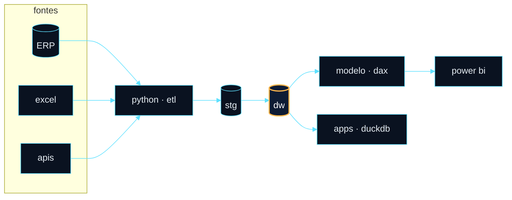

<p align="center">
  
</p>

<p align="center">
  <a href="https://www.linkedin.com/in/davi-souza-40b3892a6/"></a>
  <a href="mailto:davi.santos07@souunit.com.br"></a>
</p>

<h3 align="center">about</h3>

<p align="center">
  Data &amp; BI developer. I turn raw data into models, dashboards and tools people actually use.
</p>

<p align="center">
  <sub>
    data warehouse &amp; sql&nbsp;&nbsp;·&nbsp;&nbsp;power bi / dax&nbsp;&nbsp;·&nbsp;&nbsp;python for etl &amp; automation&nbsp;&nbsp;·&nbsp;&nbsp;data apps with typescript
  </sub>
</p>

<h3 align="center">pipeline</h3>



<h3 align="center">stack</h3>

<p align="center">
  
  
  
  
  
  
  
  <br />
  
  
  
  
  
</p>

<details>
<summary><b>projects</b> · clique para abrir</summary>
<br />

| repo | stack |
|---|---|
| [parada-obrigatoria](https://github.com/davistz/parada-obrigatoria) | HTML |
| [front-agrese](https://github.com/davistz/front-agrese) | TypeScript |
| [ApiCotas](https://github.com/davistz/ApiCotas) · [frontend](https://github.com/davistz/ApiCotas-frontend) | C# |
| [Task-Manager](https://github.com/davistz/Task-Manager) | TypeScript |
| [site-bruno](https://github.com/davistz/site-bruno) · [ao vivo](https://site-bruno-nine.vercel.app) | CSS |
| [ConformPlus](https://github.com/davistz/ConformPlus) | JavaScript |
| [to-do](https://github.com/davistz/to-do) | JavaScript |

</details>

<details>
<summary><b>3d</b> · minhas linguagens em barras (arraste para girar)</summary>
<br />

```stl
solid languages
facet normal 0 0 0
 outer loop
  vertex -2 -2 -1
  vertex -2 14 -1
  vertex 70 14 -1
 endloop
endfacet
facet normal 0 0 0
 outer loop
  vertex -2 -2 -1
  vertex 70 14 -1
  vertex 70 -2 -1
 endloop
endfacet
facet normal 0 0 0
 outer loop
  vertex -2 -2 0
  vertex 70 -2 0
  vertex 70 14 0
 endloop
endfacet
facet normal 0 0 0
 outer loop
  vertex -2 -2 0
  vertex 70 14 0
  vertex -2 14 0
 endloop
endfacet
facet normal 0 0 0
 outer loop
  vertex -2 -2 -1
  vertex 70 -2 -1
  vertex 70 -2 0
 endloop
endfacet
facet normal 0 0 0
 outer loop
  vertex -2 -2 -1
  vertex 70 -2 0
  vertex -2 -2 0
 endloop
endfacet
facet normal 0 0 0
 outer loop
  vertex -2 14 -1
  vertex -2 14 0
  vertex 70 14 0
 endloop
endfacet
facet normal 0 0 0
 outer loop
  vertex -2 14 -1
  vertex 70 14 0
  vertex 70 14 -1
 endloop
endfacet
facet normal 0 0 0
 outer loop
  vertex -2 -2 -1
  vertex -2 -2 0
  vertex -2 14 0
 endloop
endfacet
facet normal 0 0 0
 outer loop
  vertex -2 -2 -1
  vertex -2 14 0
  vertex -2 14 -1
 endloop
endfacet
facet normal 0 0 0
 outer loop
  vertex 70 -2 -1
  vertex 70 14 -1
  vertex 70 14 0
 endloop
endfacet
facet normal 0 0 0
 outer loop
  vertex 70 -2 -1
  vertex 70 14 0
  vertex 70 -2 0
 endloop
endfacet
facet normal 0 0 0
 outer loop
  vertex 2 2 0
  vertex 2 10 0
  vertex 10 10 0
 endloop
endfacet
facet normal 0 0 0
 outer loop
  vertex 2 2 0
  vertex 10 10 0
  vertex 10 2 0
 endloop
endfacet
facet normal 0 0 0
 outer loop
  vertex 2 2 54.0
  vertex 10 2 54.0
  vertex 10 10 54.0
 endloop
endfacet
facet normal 0 0 0
 outer loop
  vertex 2 2 54.0
  vertex 10 10 54.0
  vertex 2 10 54.0
 endloop
endfacet
facet normal 0 0 0
 outer loop
  vertex 2 2 0
  vertex 10 2 0
  vertex 10 2 54.0
 endloop
endfacet
facet normal 0 0 0
 outer loop
  vertex 2 2 0
  vertex 10 2 54.0
  vertex 2 2 54.0
 endloop
endfacet
facet normal 0 0 0
 outer loop
  vertex 2 10 0
  vertex 2 10 54.0
  vertex 10 10 54.0
 endloop
endfacet
facet normal 0 0 0
 outer loop
  vertex 2 10 0
  vertex 10 10 54.0
  vertex 10 10 0
 endloop
endfacet
facet normal 0 0 0
 outer loop
  vertex 2 2 0
  vertex 2 2 54.0
  vertex 2 10 54.0
 endloop
endfacet
facet normal 0 0 0
 outer loop
  vertex 2 2 0
  vertex 2 10 54.0
  vertex 2 10 0
 endloop
endfacet
facet normal 0 0 0
 outer loop
  vertex 10 2 0
  vertex 10 10 0
  vertex 10 10 54.0
 endloop
endfacet
facet normal 0 0 0
 outer loop
  vertex 10 2 0
  vertex 10 10 54.0
  vertex 10 2 54.0
 endloop
endfacet
facet normal 0 0 0
 outer loop
  vertex 16 2 0
  vertex 16 10 0
  vertex 24 10 0
 endloop
endfacet
facet normal 0 0 0
 outer loop
  vertex 16 2 0
  vertex 24 10 0
  vertex 24 2 0
 endloop
endfacet
facet normal 0 0 0
 outer loop
  vertex 16 2 25.32
  vertex 24 2 25.32
  vertex 24 10 25.32
 endloop
endfacet
facet normal 0 0 0
 outer loop
  vertex 16 2 25.32
  vertex 24 10 25.32
  vertex 16 10 25.32
 endloop
endfacet
facet normal 0 0 0
 outer loop
  vertex 16 2 0
  vertex 24 2 0
  vertex 24 2 25.32
 endloop
endfacet
facet normal 0 0 0
 outer loop
  vertex 16 2 0
  vertex 24 2 25.32
  vertex 16 2 25.32
 endloop
endfacet
facet normal 0 0 0
 outer loop
  vertex 16 10 0
  vertex 16 10 25.32
  vertex 24 10 25.32
 endloop
endfacet
facet normal 0 0 0
 outer loop
  vertex 16 10 0
  vertex 24 10 25.32
  vertex 24 10 0
 endloop
endfacet
facet normal 0 0 0
 outer loop
  vertex 16 2 0
  vertex 16 2 25.32
  vertex 16 10 25.32
 endloop
endfacet
facet normal 0 0 0
 outer loop
  vertex 16 2 0
  vertex 16 10 25.32
  vertex 16 10 0
 endloop
endfacet
facet normal 0 0 0
 outer loop
  vertex 24 2 0
  vertex 24 10 0
  vertex 24 10 25.32
 endloop
endfacet
facet normal 0 0 0
 outer loop
  vertex 24 2 0
  vertex 24 10 25.32
  vertex 24 2 25.32
 endloop
endfacet
facet normal 0 0 0
 outer loop
  vertex 30 2 0
  vertex 30 10 0
  vertex 38 10 0
 endloop
endfacet
facet normal 0 0 0
 outer loop
  vertex 30 2 0
  vertex 38 10 0
  vertex 38 2 0
 endloop
endfacet
facet normal 0 0 0
 outer loop
  vertex 30 2 19.56
  vertex 38 2 19.56
  vertex 38 10 19.56
 endloop
endfacet
facet normal 0 0 0
 outer loop
  vertex 30 2 19.56
  vertex 38 10 19.56
  vertex 30 10 19.56
 endloop
endfacet
facet normal 0 0 0
 outer loop
  vertex 30 2 0
  vertex 38 2 0
  vertex 38 2 19.56
 endloop
endfacet
facet normal 0 0 0
 outer loop
  vertex 30 2 0
  vertex 38 2 19.56
  vertex 30 2 19.56
 endloop
endfacet
facet normal 0 0 0
 outer loop
  vertex 30 10 0
  vertex 30 10 19.56
  vertex 38 10 19.56
 endloop
endfacet
facet normal 0 0 0
 outer loop
  vertex 30 10 0
  vertex 38 10 19.56
  vertex 38 10 0
 endloop
endfacet
facet normal 0 0 0
 outer loop
  vertex 30 2 0
  vertex 30 2 19.56
  vertex 30 10 19.56
 endloop
endfacet
facet normal 0 0 0
 outer loop
  vertex 30 2 0
  vertex 30 10 19.56
  vertex 30 10 0
 endloop
endfacet
facet normal 0 0 0
 outer loop
  vertex 38 2 0
  vertex 38 10 0
  vertex 38 10 19.56
 endloop
endfacet
facet normal 0 0 0
 outer loop
  vertex 38 2 0
  vertex 38 10 19.56
  vertex 38 2 19.56
 endloop
endfacet
facet normal 0 0 0
 outer loop
  vertex 44 2 0
  vertex 44 10 0
  vertex 52 10 0
 endloop
endfacet
facet normal 0 0 0
 outer loop
  vertex 44 2 0
  vertex 52 10 0
  vertex 52 2 0
 endloop
endfacet
facet normal 0 0 0
 outer loop
  vertex 44 2 17.76
  vertex 52 2 17.76
  vertex 52 10 17.76
 endloop
endfacet
facet normal 0 0 0
 outer loop
  vertex 44 2 17.76
  vertex 52 10 17.76
  vertex 44 10 17.76
 endloop
endfacet
facet normal 0 0 0
 outer loop
  vertex 44 2 0
  vertex 52 2 0
  vertex 52 2 17.76
 endloop
endfacet
facet normal 0 0 0
 outer loop
  vertex 44 2 0
  vertex 52 2 17.76
  vertex 44 2 17.76
 endloop
endfacet
facet normal 0 0 0
 outer loop
  vertex 44 10 0
  vertex 44 10 17.76
  vertex 52 10 17.76
 endloop
endfacet
facet normal 0 0 0
 outer loop
  vertex 44 10 0
  vertex 52 10 17.76
  vertex 52 10 0
 endloop
endfacet
facet normal 0 0 0
 outer loop
  vertex 44 2 0
  vertex 44 2 17.76
  vertex 44 10 17.76
 endloop
endfacet
facet normal 0 0 0
 outer loop
  vertex 44 2 0
  vertex 44 10 17.76
  vertex 44 10 0
 endloop
endfacet
facet normal 0 0 0
 outer loop
  vertex 52 2 0
  vertex 52 10 0
  vertex 52 10 17.76
 endloop
endfacet
facet normal 0 0 0
 outer loop
  vertex 52 2 0
  vertex 52 10 17.76
  vertex 52 2 17.76
 endloop
endfacet
facet normal 0 0 0
 outer loop
  vertex 58 2 0
  vertex 58 10 0
  vertex 66 10 0
 endloop
endfacet
facet normal 0 0 0
 outer loop
  vertex 58 2 0
  vertex 66 10 0
  vertex 66 2 0
 endloop
endfacet
facet normal 0 0 0
 outer loop
  vertex 58 2 2.28
  vertex 66 2 2.28
  vertex 66 10 2.28
 endloop
endfacet
facet normal 0 0 0
 outer loop
  vertex 58 2 2.28
  vertex 66 10 2.28
  vertex 58 10 2.28
 endloop
endfacet
facet normal 0 0 0
 outer loop
  vertex 58 2 0
  vertex 66 2 0
  vertex 66 2 2.28
 endloop
endfacet
facet normal 0 0 0
 outer loop
  vertex 58 2 0
  vertex 66 2 2.28
  vertex 58 2 2.28
 endloop
endfacet
facet normal 0 0 0
 outer loop
  vertex 58 10 0
  vertex 58 10 2.28
  vertex 66 10 2.28
 endloop
endfacet
facet normal 0 0 0
 outer loop
  vertex 58 10 0
  vertex 66 10 2.28
  vertex 66 10 0
 endloop
endfacet
facet normal 0 0 0
 outer loop
  vertex 58 2 0
  vertex 58 2 2.28
  vertex 58 10 2.28
 endloop
endfacet
facet normal 0 0 0
 outer loop
  vertex 58 2 0
  vertex 58 10 2.28
  vertex 58 10 0
 endloop
endfacet
facet normal 0 0 0
 outer loop
  vertex 66 2 0
  vertex 66 10 0
  vertex 66 10 2.28
 endloop
endfacet
facet normal 0 0 0
 outer loop
  vertex 66 2 0
  vertex 66 10 2.28
  vertex 66 2 2.28
 endloop
endfacet
endsolid languages
```

<sub>TypeScript 45.0% · CSS 21.1% · JavaScript 16.3% · HTML 14.8% · C# 1.9% · da esquerda para a direita</sub>

</details>

<h3 align="center">run a query</h3>

<p align="center">
  <a href="https://github.com/davistz/davistz/issues/new?body=S%C3%B3+clicar+em+%22Create%22.+Um+bot+roda+a+query+e+responde+aqui.&title=query%3A+top_languages" title="roda top_languages nos meus repositórios"><code>top_languages</code></a> · <a href="https://github.com/davistz/davistz/issues/new?body=S%C3%B3+clicar+em+%22Create%22.+Um+bot+roda+a+query+e+responde+aqui.&title=query%3A+recent_repos" title="roda recent_repos nos meus repositórios"><code>recent_repos</code></a> · <a href="https://github.com/davistz/davistz/issues/new?body=S%C3%B3+clicar+em+%22Create%22.+Um+bot+roda+a+query+e+responde+aqui.&title=query%3A+biggest_repos" title="roda biggest_repos nos meus repositórios"><code>biggest_repos</code></a> · <a href="https://github.com/davistz/davistz/issues/new?body=S%C3%B3+clicar+em+%22Create%22.+Um+bot+roda+a+query+e+responde+aqui.&title=query%3A+leaderboard" title="roda leaderboard nos meus repositórios"><code>leaderboard</code></a>
</p>
<p align="center"><sub>clique numa query · o GitHub abre uma issue · clique em Create · um bot roda em SQLite sobre meus repositórios e publica o resultado aqui</sub></p>

<!-- QUERY:START -->
<p align="center"><sub>nenhuma query rodada ainda. seja o primeiro.</sub></p>
<!-- QUERY:END -->

<h3 align="center">stats</h3>

<p align="center">
  <picture>
    <source media="(prefers-color-scheme: dark)" srcset="https://streak-stats.demolab.com/?user=davistz&disable_animations=true&background=0D1117&border=30363D&stroke=30363D&ring=5FE1FF&fire=FFB84D&currStreakNum=FFFFFF&sideNums=FFFFFF&currStreakLabel=5FE1FF&sideLabels=8B949E&dates=8B949E" />
    <source media="(prefers-color-scheme: light)" srcset="https://streak-stats.demolab.com/?user=davistz&disable_animations=true&background=FFFFFF&border=D0D7DE&stroke=D0D7DE&ring=0969DA&fire=BF8700&currStreakNum=1F2328&sideNums=1F2328&currStreakLabel=0969DA&sideLabels=59636E&dates=59636E" />
    
  </picture>
</p>

<p align="center">
  <picture>
    <source media="(prefers-color-scheme: dark)" srcset="https://raw.githubusercontent.com/davistz/davistz/output/snake-dark.svg" />
    <source media="(prefers-color-scheme: light)" srcset="https://raw.githubusercontent.com/davistz/davistz/output/snake-light.svg" />
    
  </picture>
</p>
